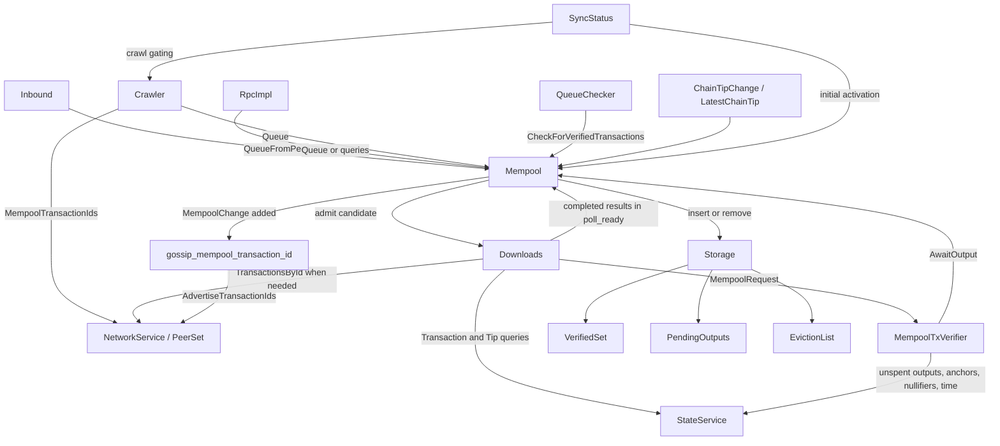

# Mempool architecture diagram

The [`Mempool` service][mempool] owns storage and download/verification tasks.
The downloader returns candidates; only the service admits them to storage.
Arrows carry requests or events; `gossip_mempool_transaction_id` is a task,
not a Tower service.

## Components

| Component | Responsibility |
| --- | --- |
| [`Mempool`][mempool] | Dispatch requests, collect completed verification results in `poll_ready`, update storage for tip changes, and publish `MempoolChange` events. |
| [`Downloads`][downloads] | Deduplicate queued candidates, enforce global and per-peer admission bounds, check whether a transaction is already mined, download missing bytes, and call the verifier. |
| [`MempoolTxVerifier`][verifier] | Verify for the next block height using chain state and, for transparent dependencies, outputs awaited from the mempool. |
| [`Storage`][storage] | Apply standardness and cost-limit policy; own the verified set, pending-output requests, and rejection caches. |
| [`VerifiedSet`][verified] | Index transactions, created and spent outputs, nullifiers, and dependencies; perform weighted eviction and remove dependent transactions. |
| [`PendingOutputs`][pending] | Hold callers waiting for transparent outputs and respond when a parent transaction is inserted. |
| [`EvictionList`][eviction] | Retain bounded, timed lists of transaction IDs rejected for chain effects, including random eviction. |
| [`Crawler`][crawler] | Query peer mempools and queue returned IDs. |
| [`QueueChecker`][checker] | Trigger completion processing without external requests. |
| [`gossip_mempool_transaction_id`][gossip] | Consume added-transaction events, combine available IDs, and advertise them through the network service. |

The [mempool specification](../mempool-specification.md) defines activation,
task startup and timing, admission, eviction, rejection lifetimes, tip resets,
and the service API.

[mempool]: https://github.com/ZcashFoundation/zebra/blob/main/zebrad/src/components/mempool.rs
[downloads]: https://github.com/ZcashFoundation/zebra/blob/main/zebrad/src/components/mempool/downloads.rs
[verifier]: https://github.com/ZcashFoundation/zebra/blob/main/zebra-consensus/src/transaction.rs
[storage]: https://github.com/ZcashFoundation/zebra/blob/main/zebrad/src/components/mempool/storage.rs
[verified]: https://github.com/ZcashFoundation/zebra/blob/main/zebrad/src/components/mempool/storage/verified_set.rs
[pending]: https://github.com/ZcashFoundation/zebra/blob/main/zebrad/src/components/mempool/pending_outputs.rs
[eviction]: https://github.com/ZcashFoundation/zebra/blob/main/zebrad/src/components/mempool/storage/eviction_list.rs
[crawler]: https://github.com/ZcashFoundation/zebra/blob/main/zebrad/src/components/mempool/crawler.rs
[checker]: https://github.com/ZcashFoundation/zebra/blob/main/zebrad/src/components/mempool/queue_checker.rs
[gossip]: https://github.com/ZcashFoundation/zebra/blob/main/zebrad/src/components/mempool/gossip.rs
