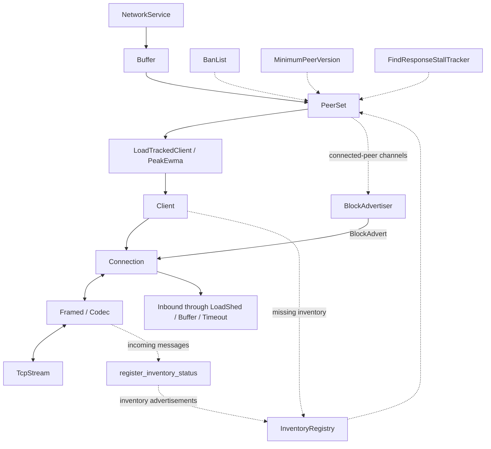
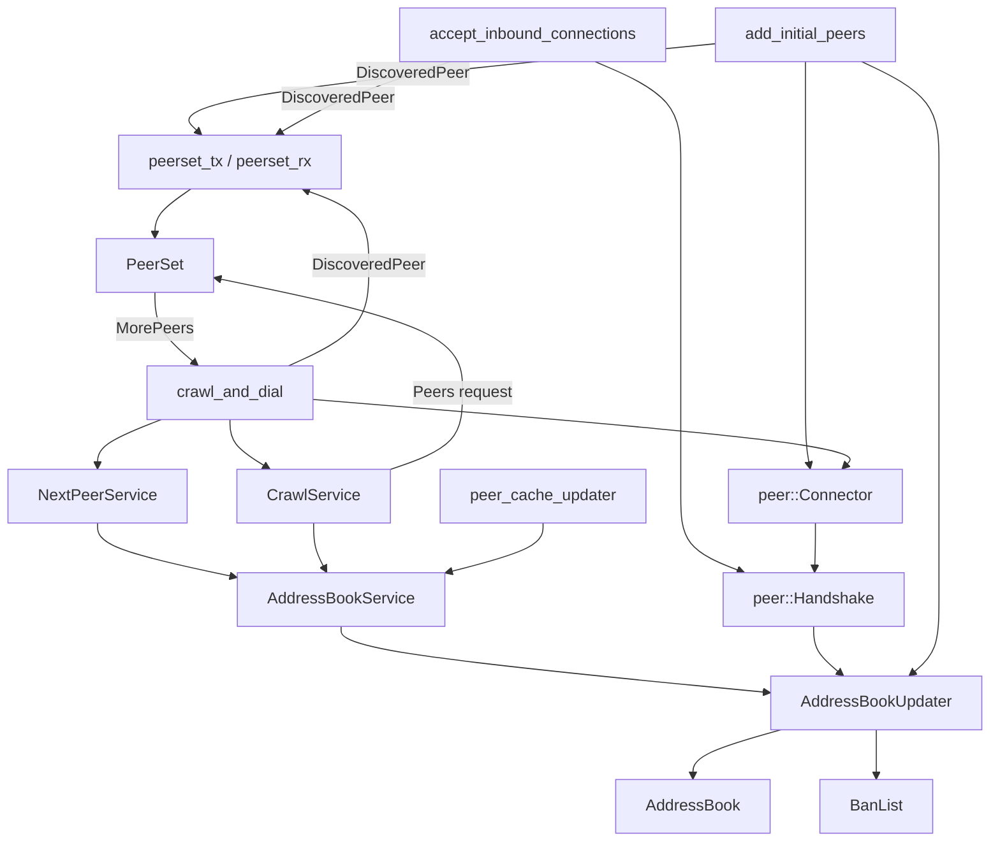

# Zebra network architecture

The [`zebra-network` crate][network] translates the bidirectional Zcash wire
protocol into [Tower services](../overview.md#service-dependencies) accepting
`Request` values and returning `Response` values. Each peer has a `Connection`
task and `Client` handle. The application supplies an inbound service for remote
requests; a `NetworkService` handle routes the application's outbound requests.

## Requests and connections

Solid arrows carry requests or wire messages. Dotted arrows carry metadata or
peer-set updates. Response futures return to the requesting caller.

The [handshake][handshake] constructs the framed transport, client channels, and
connection task. Its incoming-message pipeline records inventory advertisements
and transport errors before delivering messages to the connection. A separate,
rate-limited heartbeat task updates address liveness after successful ping
responses. The [client][client] also records missing-inventory responses. The
[load wrapper][load] uses Tower's `PeakEwma` estimator, which tracks recent
response latency, for load-sensitive selection.

The [peer set][set] routes requests by class:

| Request | Routing |
| --- | --- |
| `FindBlocks`, `FindHeaders` | Fair rotation across ready connections, preferring serving peers for up to 1.5 seconds. Fast empty replies do not gain a latency-based routing advantage. |
| `BlockDownload`, single-item `BlocksByHash`, single-item `TransactionsById` | Inventory-aware selection prefers a peer that advertised the item and excludes peers recorded as missing it. Block requests can wait for a suitable busy peer; transaction requests do not use that wait. |
| `AdvertiseTransactionIds` | Broadcast to a randomly selected subset of ready peers, rather than selecting by latency. |
| `PushTransaction` | Broadcast with additional handling for configured zcashd-compat sidecar peers. |
| Other ordinary requests | Power-of-two-choices selection: sample two ready peers and choose the less loaded one. |
| `AdvertiseBlock`, `AdvertiseBlockToAll` | Rejected on the ordinary network service; callers must use `BlockAdvertiser`. |

The dedicated [block advertiser][advertiser] has its own concurrency bound and
per-connection channels. A busy ordinary request does not prevent a connection
from receiving a block advertisement. Successful advertisement completion means
the selected connections completed their local transport writes, not that remote
peers received or accepted the block.

The [inbound stack][inbound-stack] bounds remote requests with load shedding, a
buffer, and a response timeout. The [connection task][connection] interprets
incoming messages as responses to outstanding requests or inbound requests.

## Discovery and address state

The [initializer][initialize] adds peer clients from accepted inbound
connections, initial seed/cache connections, and the crawler.

The initial-peer task resolves configured seed addresses and reads the peer
cache. The [candidate services][candidates] select outbound candidates from the
address book and store addresses learned from peer crawls. Candidate selection
and crawling have separate rate limits. The [crawl-and-dial loop][initialize]
crawls on its timer or when the peer set requests more peers and no candidates
are available. Dialing respects the configured connection limits.

The [address-book updater][updater] owns address mutations and publishes ban
updates. The [peer-set maintenance path][set] removes failed, banned, or
protocol-ineligible connections and handles queued requests when suitable peers
become available. The minimum protocol version follows the local chain tip;
network-upgrade behavior is specified by [ZIP 201][zip201].

## Ownership and shutdown

A [`NetworkService`][service] handle owns the network's worker and background
tasks. Its clones and unfinished response futures keep those tasks alive.
Releasing the last owner stops the tasks and releases the listener and peer
connections.

Services retained by the network, including the inbound handler's downloaders
and mempool, use `NetworkService::background_service()`. That handle shares the
existing buffer without owning network lifetime, avoiding a reference cycle.
A [`BlockAdvertiser`][advertiser] handle also requires an external owning network
handle to remain alive.

[network]: https://github.com/ZcashFoundation/zebra/blob/main/zebra-network/src/lib.rs
[initialize]: https://github.com/ZcashFoundation/zebra/blob/main/zebra-network/src/peer_set/initialize.rs
[handshake]: https://github.com/ZcashFoundation/zebra/blob/main/zebra-network/src/peer/handshake.rs
[client]: https://github.com/ZcashFoundation/zebra/blob/main/zebra-network/src/peer/client.rs
[connection]: https://github.com/ZcashFoundation/zebra/blob/main/zebra-network/src/peer/connection.rs
[load]: https://github.com/ZcashFoundation/zebra/blob/main/zebra-network/src/peer/load_tracked_client.rs
[set]: https://github.com/ZcashFoundation/zebra/blob/main/zebra-network/src/peer_set/set.rs
[advertiser]: https://github.com/ZcashFoundation/zebra/blob/main/zebra-network/src/peer_set.rs
[inbound-stack]: https://github.com/ZcashFoundation/zebra/blob/main/zebrad/src/commands/start.rs#L366-L395
[candidates]: https://github.com/ZcashFoundation/zebra/blob/main/zebra-network/src/peer_set/candidate_set.rs
[updater]: https://github.com/ZcashFoundation/zebra/blob/main/zebra-network/src/address_book_updater.rs
[service]: https://github.com/ZcashFoundation/zebra/blob/main/zebra-network/src/peer_set/service.rs
[zip201]: https://zips.z.cash/zip-0201
