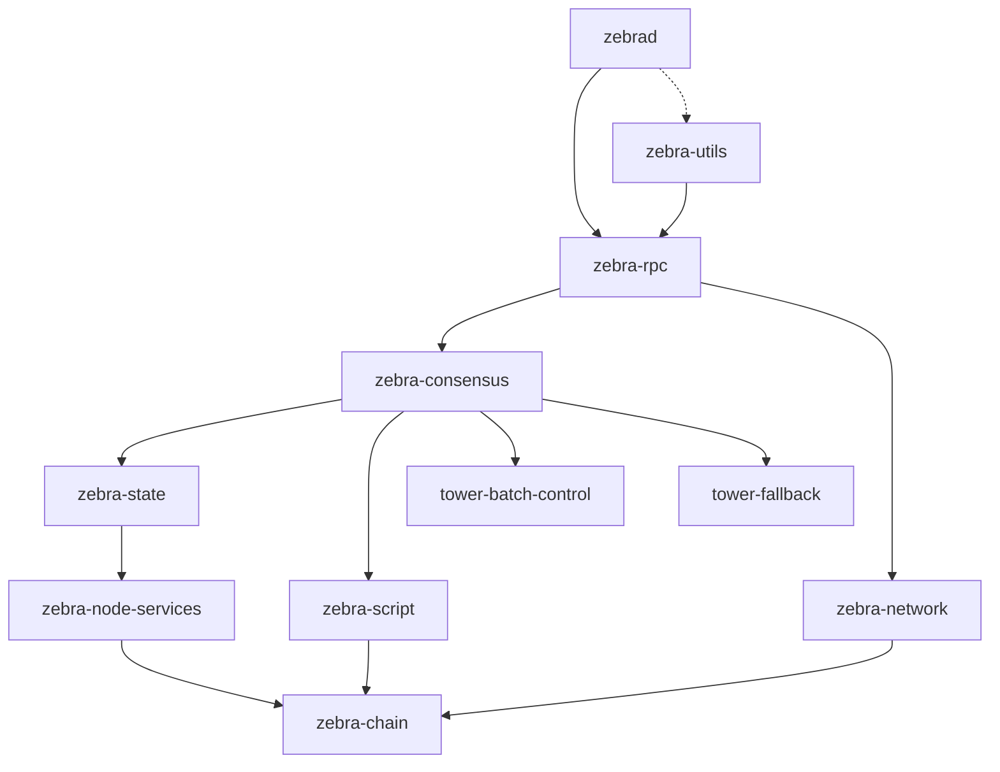
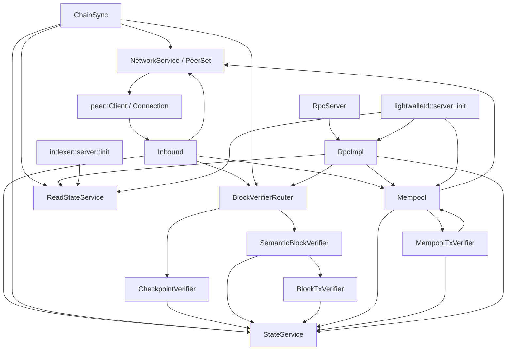
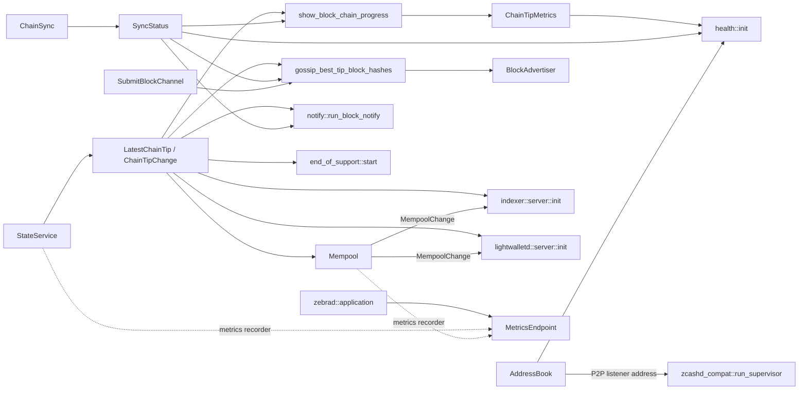

# Architecture

Zebra separates protocol data, networking, consensus verification, chain state,
and RPC into Rust crates. The [`zebrad` application][start] connects their
services and runs synchronization and the mempool. A crate dependency is not
necessarily a service call.

## Crates

The [root workspace][workspace] contains these crates:

| Crate | Responsibility | Manifest |
| --- | --- | --- |
| [`zebra-chain`][chain] | Blocks, transactions, addresses, amounts, network parameters, serialization, and cryptographic data types. | [Cargo.toml][chain-manifest] |
| [`zebra-network`][network] | Peer connections, wire messages, address discovery, inventory tracking, and outbound request routing. | [Cargo.toml][network-manifest] |
| [`zebra-script`][script] | Transparent script verification through `libzcash_script`; the default interpreter is C++, with an optional C++/Rust comparison interpreter. | [Cargo.toml][script-manifest] |
| [`zebra-consensus`][consensus] | Checkpoint verification, semantic block verification, block and mempool transaction verification, and cryptographic verification services. | [Cargo.toml][consensus-manifest] |
| [`zebra-state`][state] | Contextual verification, finalized and non-finalized chain storage, chain queries, and tip notifications. | [Cargo.toml][state-manifest] |
| [`zebra-node-services`][node-services] | Shared mempool request/response types, service traits, and an optional RPC client. It does not implement the mempool. | [Cargo.toml][node-services-manifest] |
| [`zebra-rpc`][rpc] | JSON-RPC methods and server, RPC client, indexer gRPC server, and lightwalletd-compatible gRPC server. | [Cargo.toml][rpc-manifest] |
| [`zebrad`][start] | CLI and configuration, service assembly, synchronization, inbound requests, mempool, monitoring, notifications, and optional zcashd supervision. | [Cargo.toml][zebrad-manifest] |
| [`tower-batch-control`][batch] | Tower middleware that collects weighted requests and flushes batches by size or latency. | [Cargo.toml][batch-manifest] |
| [`tower-fallback`][fallback] | Tower middleware that retries a request on a second service when its fallback policy selects it. Consensus uses it for individual verification after a batch fails. | [Cargo.toml][fallback-manifest] |
| [`zebra-utils`][utils] | Developer tools, including `zebra-checkpoints`, `search-issue-refs`, and `block-template-to-proposal`. | [Cargo.toml][utils-manifest] |
| [`zebra-test`][test] | Shared test harnesses, test vectors, service mocks, and test initialization. | [Cargo.toml][test-manifest] |

The `zebra-fuzz/` directory contains the separate, unpublished
[`zebra-fuzz-targets` workspace][fuzz-manifest]. Its executable targets exercise
transaction and block decoding, consensus checks, scripts, P2P messages, and RPC.
It is not a root-workspace member or a node runtime component.

The `zebra-scan` and `zebra-grpc` crates were removed in
[Zebra 2.4.0][removed-crates]; their names do not refer to the current gRPC servers.

## Crate dependencies

An arrow points from a crate to an in-repository crate it depends on, as
declared in the manifests above. A crate also depends on every crate reachable
from it, so the graph omits each edge that a longer path already implies: for
example, `zebrad` and `zebra-rpc` both declare `zebra-chain` directly. The
dotted arrow is an optional dependency. The graph omits external crates and
`zebra-test`, which every crate in the graph except `zebra-node-services` and
`zebra-utils` uses as a development dependency, and which `zebra-chain` and
`zebra-state` also pull in optionally for their `proptest-impl` features (and
`zebra-chain` for its `bench` feature).

The fuzz targets, in their own workspace, depend on `zebra-chain`,
`zebra-consensus`, `zebra-network`, `zebra-node-services`, `zebra-rpc`,
`zebra-script`, and `zebra-state`.

The direct `zebrad` dependency on `zebra-script` forwards the optional
[`comparison-interpreter` feature](../user/install.md#cargo-features).
The daemon does not call the library directly.

## Service dependencies

A Tower service accepts typed requests and returns response futures. The
[start command][start] wraps shared services in bounded buffers and connects them
with cloned handles. The [consensus router initializer][router] constructs two
transaction verifier services: `BlockTxVerifier` for transactions in blocks and
`MempoolTxVerifier` for unmined transactions. The latter can query the mempool for
outputs created by unconfirmed parent transactions.

Arrows below point from a caller to a service it uses, omitting middleware and
download queues. Peer connections call the inbound service; the peer set routes
outbound requests to those connections. The state exposes read/write and
read-only services over the same database.

The [startup function][start-tasks] also connects background tasks and optional
endpoints. Arrows carry notifications or requests. The mempool's background
tasks appear in the [mempool diagram](diagrams/mempool-architecture.md).

The [application][application] registers `MetricsEndpoint` outside
`StartCmd::start`. For activation conditions, see the
[configuration reference](../user/config.md) and
[end-of-support policy](../user/run.md#end-of-support).

## Verification stages

Zebra separates checks to overlap independent work without accepting a block
before its ancestors. The stages follow
[RFC 0002](rfcs/0002-parallel-verification.md#verification-stages):

1. **Structural verification** parses protocol bytes into valid data structures.
   The [`zebra-chain` deserializers][serialization] enforce representation
   constraints, including [transaction encodings][protocol-encoding] and bounded
   fields.
2. **Semantic verification** checks a block or transaction's
   [internal rules][protocol-tx], signatures, proofs, and scripts, overlapping
   with parent-block verification. Script checks still need spent outputs.
   The [transaction verifiers][transactions] obtain them and assemble concurrent
   checks; the [semantic block verifier][blocks] combines their results.
3. **Contextual verification** checks the parent, height, difficulty, spent
   outputs, nullifiers, commitments, and value-pool changes against a particular
   chain. The [state write path][state-write] applies these
   [checks][state-checks], including the protocol's
   [block-header rules][protocol-block], before committing to non-finalized state.

For transaction admission without a block commit, see
[mempool contextual checks](mempool-specification.md#candidate-admission-and-verification).

### Checkpoint and full verification

A checkpoint is a configured block hash at a known height. The
[`CheckpointVerifier`][checkpoints] checks linked ranges against the checkpoint
list instead of individually verifying their transaction signatures and proofs.
It still checks block heights, proof of work where enabled, Merkle roots, and
transaction-hash uniqueness. The [finalized-state commit path][finalized] checks
the chain-history and authorizing-data commitments before storing these blocks;
a matching checkpoint hash alone does not authorize arbitrary transaction data.

The [router][router] selects checkpoint verification at or below its maximum
checkpoint height and full semantic verification above it. The maximum is
either the last checkpoint or the first at or above the mandatory height,
as set by [consensus configuration](../user/config.md#consensus). Mandatory
checkpoints cannot be disabled: Zebra cannot fully verify
[pre-Canopy history][mandatory-checkpoint].

At startup, the [consensus initializer][router] also compares cached best-chain
hashes with the checkpoint list, stopping at the first height not yet stored.
This runs regardless of checkpoint-sync configuration. A mismatch panics.

### Finalized and non-finalized state

The [state implementation][state-service] maintains two parts:

- **Finalized state** stores one chain in RocksDB. Checkpoint-verified blocks go
  directly here, in chain order.
- **Non-finalized state** holds recently verified competing chains in memory,
  ordered by accumulated work. A full-verification commit first enters this
  state. The write worker finalizes the oldest block of the best chain whenever
  that chain exceeds the rollback window.

The rollback window is **1,000 blocks**, defined by
[`MAX_BLOCK_REORG_HEIGHT`][reorg-limit]. It is Zebra's local policy, not a Zcash
consensus rule. Reorganizations cannot replace blocks already finalized by this
node.

With backups enabled, persistent state restores recent blocks from a
[non-finalized backup](state-db-upgrades.md#non-finalized-state-backup);
see the [state settings](../user/config.md#state).

The [`StateService` interface][state-service] accepts mutations and queries.
The `ReadStateService` interface processes `ReadRequest` queries without sharing
the write service's request buffer. Both read the same finalized database and
published non-finalized state. The `LatestChainTip` and `ChainTipChange` handles
publish tip information without a state-service round trip.

## Block flow

1. The `ChainSync` task discovers block hashes through peers. The `Inbound`
   service also accepts block advertisements. Their respective
   [sync downloader][sync-downloads] and [inbound downloader][inbound-downloads]
   request blocks through the network service.
2. The [peer connection][network] decodes wire messages into `zebra-chain` data.
   The downloaders submit `zebra_consensus::Request::Commit` to the
   [block verifier router][router].
3. The checkpoint path validates a hash-linked range and submits
   `CommitCheckpointVerifiedBlock`. The full path runs `SemanticBlockVerifier`
   and `BlockTxVerifier`, then submits `CommitSemanticallyVerifiedBlock`.
   The [checkpoint][checkpoints] and [semantic][blocks] verifiers return success
   only after their state commit succeeds.
4. The [state service][state-service] queues out-of-order blocks until their
   parents are available. Its [write worker][state-write] commits checkpoint
   blocks to finalized state, or contextually verifies full-path blocks into
   non-finalized state and later finalizes them at the rollback limit.
5. The state publishes the changed best tip. The [block gossip task][start-tasks]
   sends its hash through `BlockAdvertiser`; RPC and other tip subscribers can
   observe the committed chain. A successful full-path commit does not mean the
   new block has already reached finalized storage.

## Transaction flow

The mempool accepts candidates from inbound peers, its crawler, and RPC.
The [admission pipeline](mempool-specification.md#candidate-admission-and-verification)
downloads and verifies them before applying storage policy;
[gossip](mempool-specification.md#crawling-queue-checks-and-gossip) advertises
accepted IDs.

## Concurrency

The daemon creates a [multithreaded Tokio runtime][tokio]. Tower readiness and
bounded buffers control admission to shared services; futures let independent
network and verification operations overlap. Startup uses one-shot channels to
complete the cycles between inbound networking, mempool, and transaction
verification after the handles exist.

Cryptographic services use [`tower-batch-control`][batch] to aggregate requests
without requiring each caller to assemble a batch. The
[`tower-fallback`][fallback] wrapper falls back to individual verification when
a batch fails; for example, the [Ed25519 service][ed25519] composes both.

CPU-heavy work runs outside ordinary asynchronous task polling. The
[Ed25519 verifier][ed25519] submits work to Rayon, while the
[Sapling verifier][sapling] uses `tokio::task::spawn_blocking` for batch validation.
The [application][application] initializes Rayon; see
[CPU-thread configuration](../user/config.md#sync). State reads use blocking
tasks; state writes run in a dedicated [write-worker thread][state-write].
Channels publish updated state to readers; block commits remain ordered even
when verification completes out of order.

[workspace]: https://github.com/ZcashFoundation/zebra/blob/main/Cargo.toml
[chain]: https://github.com/ZcashFoundation/zebra/blob/main/zebra-chain/src/lib.rs
[network]: https://github.com/ZcashFoundation/zebra/blob/main/zebra-network/src/lib.rs
[script]: https://github.com/ZcashFoundation/zebra/blob/main/zebra-script/src/lib.rs
[consensus]: https://github.com/ZcashFoundation/zebra/blob/main/zebra-consensus/src/lib.rs
[state]: https://github.com/ZcashFoundation/zebra/blob/main/zebra-state/src/lib.rs
[node-services]: https://github.com/ZcashFoundation/zebra/blob/main/zebra-node-services/src/lib.rs
[rpc]: https://github.com/ZcashFoundation/zebra/blob/main/zebra-rpc/src/lib.rs
[batch]: https://github.com/ZcashFoundation/zebra/blob/main/tower-batch-control/src/lib.rs
[fallback]: https://github.com/ZcashFoundation/zebra/blob/main/tower-fallback/src/lib.rs
[utils]: https://github.com/ZcashFoundation/zebra/blob/main/zebra-utils/src/lib.rs
[test]: https://github.com/ZcashFoundation/zebra/blob/main/zebra-test/src/lib.rs
[chain-manifest]: https://github.com/ZcashFoundation/zebra/blob/main/zebra-chain/Cargo.toml
[network-manifest]: https://github.com/ZcashFoundation/zebra/blob/main/zebra-network/Cargo.toml
[script-manifest]: https://github.com/ZcashFoundation/zebra/blob/main/zebra-script/Cargo.toml
[consensus-manifest]: https://github.com/ZcashFoundation/zebra/blob/main/zebra-consensus/Cargo.toml
[state-manifest]: https://github.com/ZcashFoundation/zebra/blob/main/zebra-state/Cargo.toml
[node-services-manifest]: https://github.com/ZcashFoundation/zebra/blob/main/zebra-node-services/Cargo.toml
[rpc-manifest]: https://github.com/ZcashFoundation/zebra/blob/main/zebra-rpc/Cargo.toml
[zebrad-manifest]: https://github.com/ZcashFoundation/zebra/blob/main/zebrad/Cargo.toml
[batch-manifest]: https://github.com/ZcashFoundation/zebra/blob/main/tower-batch-control/Cargo.toml
[fallback-manifest]: https://github.com/ZcashFoundation/zebra/blob/main/tower-fallback/Cargo.toml
[utils-manifest]: https://github.com/ZcashFoundation/zebra/blob/main/zebra-utils/Cargo.toml
[test-manifest]: https://github.com/ZcashFoundation/zebra/blob/main/zebra-test/Cargo.toml
[fuzz-manifest]: https://github.com/ZcashFoundation/zebra/blob/main/zebra-fuzz/fuzz/Cargo.toml
[removed-crates]: https://github.com/ZcashFoundation/zebra/blob/main/CHANGELOG.md#L1272-L1298
[start]: https://github.com/ZcashFoundation/zebra/blob/main/zebrad/src/commands/start.rs#L341-L483
[start-tasks]: https://github.com/ZcashFoundation/zebra/blob/main/zebrad/src/commands/start.rs#L488-L725
[application]: https://github.com/ZcashFoundation/zebra/blob/main/zebrad/src/application.rs#L450-L524
[router]: https://github.com/ZcashFoundation/zebra/blob/main/zebra-consensus/src/router.rs
[serialization]: https://github.com/ZcashFoundation/zebra/tree/main/zebra-chain/src/serialization
[transactions]: https://github.com/ZcashFoundation/zebra/blob/main/zebra-consensus/src/transaction.rs
[blocks]: https://github.com/ZcashFoundation/zebra/blob/main/zebra-consensus/src/block.rs
[checkpoints]: https://github.com/ZcashFoundation/zebra/blob/main/zebra-consensus/src/checkpoint.rs
[mandatory-checkpoint]: https://github.com/ZcashFoundation/zebra/blob/main/zebra-chain/src/parameters/network.rs#L258-L274
[state-service]: https://github.com/ZcashFoundation/zebra/blob/main/zebra-state/src/service.rs
[state-write]: https://github.com/ZcashFoundation/zebra/blob/main/zebra-state/src/service/write.rs
[state-checks]: https://github.com/ZcashFoundation/zebra/tree/main/zebra-state/src/service/check
[finalized]: https://github.com/ZcashFoundation/zebra/blob/main/zebra-state/src/service/finalized_state.rs#L339-L437
[reorg-limit]: https://github.com/ZcashFoundation/zebra/blob/main/zebra-chain/src/parameters/constants.rs#L20-L33
[sync-downloads]: https://github.com/ZcashFoundation/zebra/blob/main/zebrad/src/components/sync/downloads.rs
[inbound-downloads]: https://github.com/ZcashFoundation/zebra/blob/main/zebrad/src/components/inbound/downloads.rs
[tokio]: https://github.com/ZcashFoundation/zebra/blob/main/zebrad/src/components/tokio.rs
[ed25519]: https://github.com/ZcashFoundation/zebra/blob/main/zebra-consensus/src/primitives/ed25519.rs
[sapling]: https://github.com/ZcashFoundation/zebra/blob/main/zebra-consensus/src/primitives/sapling.rs
[protocol-encoding]: https://zips.z.cash/protocol/protocol.pdf#txnencoding
[protocol-tx]: https://zips.z.cash/protocol/protocol.pdf#txnconsensus
[protocol-block]: https://zips.z.cash/protocol/protocol.pdf#blockheader
