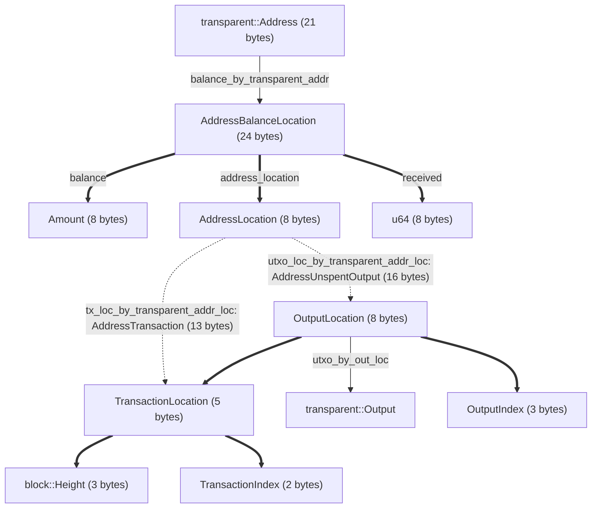

# State database format and upgrades

Zebra stores finalized chain data in RocksDB. A _column family_ is a named
key-value map within that database. The database format includes the column
family names, the byte encodings of their keys and values, and the
relationships between records.

For deployment, direct-reader compatibility, and rollback, follow
[Upgrading Zebra](../user/upgrading.md).

## Format versions and paths

The database format version is independent of Zebra and Rust crate versions.
Zebra 7.0.0 implements [format **29.0.0**][constants]:

| Constant | Current value | Change requiring a bump |
| --- | --- | --- |
| `DATABASE_FORMAT_VERSION` | `29` | An incompatible encoding change or column family removal |
| `DATABASE_FORMAT_MINOR_VERSION` | `0` | A significant compatible change, including a new column family |
| `DATABASE_FORMAT_PATCH_VERSION` | `0` | A significant format compatibility fix |

A change that would otherwise be incompatible can use a minor bump only when
all supported Zebra versions already contain the required compatibility code.
The function `state_database_format_version_in_code()` returns the complete
semantic version. Builds with the `indexer` feature return
`29.0.0+indexer`; other builds return `29.0.0`.

For persistent databases, the method `Config::db_path()` constructs this path:

```text
<state.cache_dir>/state/v<major>/<network>/
```

The network directory is `mainnet`, `testnet`, or `regtest` for the standard
networks. A configured non-Regtest Testnet uses its lowercase name followed
by `-` and its four-byte wire magic encoded as eight lowercase hexadecimal
digits. The method [`Network::directory_name()`][network-directory] defines
this namespace. Databases for the same network with different minor or patch
versions still use the same major-version directory.

The file `version` inside the database directory records the full semantic
version, for example `29.0.0` or `29.0.0+indexer`, without a trailing newline.
The [version reader][config] also accepts the legacy `minor.patch` form and
supplies the major version from the requested database path. If the file is
absent but the directory exists, it reports `<major>.0.0`. If both are absent,
it reports no database. Malformed or unreadable version files are errors,
not requests to resynchronize.

The version writer replaces the file atomically. During a reusable
major-version upgrade, the directory can temporarily contain a version file
with the preceding major version while the format upgrade is pending.

The [state configuration](../user/config.md#state) sets the cache root or selects
a temporary directory named with the database kind, major version, and network.

## Upgrading the state database

A major version selects a different directory. It does not necessarily require
resynchronization: a registered _reusable major upgrade_ permits the writer to
move a compatible database from the immediately preceding major version into
the new directory, then apply the required format changes.

The registry [`restorable_db_versions()`][upgrade] contains destination majors
`26`, `27`, `28`, and `29`. The [reuse implementation][disk-db] considers only
`current_major - 1`: format 29 reuses format 28, not format 27 or earlier.

Reuse requires all of the following:

- The current major version has a registered reusable upgrade.
- RocksDB recognizes the previous network directory as a database.
- RocksDB does not recognize an existing database at the new path.
- The canonical previous database path lies inside the canonical
  `[state] cache_dir`.
- The directory move succeeds.

The writer renames the previous network directory into the new major-version
path and records its old semantic version in the relocated `version` file.
It removes the old major-version directory if that directory is now empty.
It does not copy the database. A symlink to a database outside the cache root
is not reused. If reuse does not occur, Zebra opens the current path or creates
a new database there; an empty database requires synchronization from genesis.

### The v28-to-v29 upgrade

Format 29 adds the Network Sustainability Mechanism (NSM) balance to stored
value pools. The registered upgrade uses `NoMigration`: existing records do
not need rewriting because the new readers accept their older encodings.

| Record | Format 28 writes | Format 29 writes |
| --- | --- | --- |
| `ValueBalance<NonNegative>` | 48 bytes | 56 bytes |
| `BlockInfo` | 52 bytes | 60 bytes |

Legacy records read with a zero NSM balance; new writes use the wider encoding
even when that balance is zero. See the [byte layouts](#data-formats).

### Old-database cleanup

When enabled, the [cleanup task][config] scans major-version directories under
the database-kind root, such as `<state.cache_dir>/state`, and removes older
versions except predecessors of registered reusable upgrades. It skips current
and newer versions, paths outside the canonical cache root, and ephemeral
databases.

The current registry protects `v25` through `v28`. Cleanup removes an eligible
major-version directory as a whole, including its network subdirectories.

### Upgrade execution and validity checks

The wrapper [`ZebraDb::new()`][zebra-db] compares the on-disk version with the
running format version and chooses one of four operations:

| Database state | Operation |
| --- | --- |
| No database | Create the database and mark it with the running version |
| Older version | Apply registered upgrades in version order |
| Same version | Check the existing format |
| Newer version | Mark it with the older running version, then check it |

The last case applies to a database the binary actually opens. It is not a
mechanism for opening another major-version directory. Within a compatible
major version, recording the lower version makes a later newer writer repeat
the required upgrades over data that the older writer could have changed.
Compatibility remains the responsibility of the new format's implementation.

The [upgrade framework][upgrade] runs on a separate thread. It captures the
finalized tip at startup so migrations can process existing records while
normal block commits write the current format above that tip. For each
registered upgrade newer than the initial disk version, it:

1. Calls `prepare()`, `run()`, and `validate()` if `needs_migration()` is true.
2. Atomically records the completed upgrade's version.

An empty finalized database skips record migrations and is marked with the
running version. The trait `DiskFormatUpgrade` defaults `needs_migration()` to
`true`. Its default `is_reusable_major_upgrade()` returns true for a version
whose minor and patch components are both zero. The existing `NoMigration`
implementation sets `needs_migration()` to `false` for reader-compatible
changes that require no record rewrite.

Detailed format checks run after startup format handling. They combine quick
checks with every registered upgrade's `validate()` method. Quick checks cover
the on-disk height limit and selected tree/subtree invariants; individual
validators check their own formats. These checks do not reverify every block
or prove every database record correct. An invalid result causes a panic with
a delete-and-resynchronize diagnostic.

Consensus separately checks cached chain hashes against the checkpoint list at
startup. See [Checkpoint and full verification](overview.md#checkpoint-and-full-verification).

Writer shutdown cancels the upgrade thread and checks the format if the recorded
version has reached the running version. An interrupted upgrade retains the last
completed version and resumes the remaining work on restart.
[Periodic detailed checks](../user/config.md#state) are optional.
Read-only secondary instances skip this upgrade/check thread.

<a id="design"></a>

### Design constraints

Format upgrades run concurrently with block commits and state queries. A
migration must preserve readable, correct data at every committed batch
boundary, including cancellation and restart boundaries.

- Make readers accept the old, partial, and new states that the migration can
  expose. Return an explicit unavailable result when appropriate; do not
  silently substitute incorrect wallet or validation data.
- Reuse normal block-write calculations and encodings in migration code.
  An upgraded database and a database synchronized from genesis must represent
  the same chain identically.
- Make repeat execution safe. Cancellation can occur after a batch is committed
  but before the version file advances. Compatible downgrades can also require
  an upgrade to run again.
- Write related changes in one `DiskWriteBatch`. Separate successful writes do
  not make a multi-column change atomic.
- Check the cancellation receiver during long operations and before committing
  batches. Return `CancelFormatChange` when cancellation is requested.
- Bound work and memory use. Use bounded key ranges rather than retaining a
  long-lived iterator over unrelated records.

The current block writer demonstrates a concurrency-sensitive case: it uses
merge operations for transparent address balances while format upgrades are
pending, then switches to direct inserts after the format-upgrade flag is set.
The migration and normal writes must not overwrite each other's balance
changes. See [`ZebraDb::write_block()`][block-access] and the
[address-received upgrade][block-info-upgrade].

## Non-finalized state backup

When [enabled](../user/config.md#state) for a persistent database, non-finalized
backups use:

```text
<state.cache_dir>/non_finalized_state/<network>/<block-hash>
```

The network namespace matches the finalized database, but the backup path has
no database-format version component. The [backup implementation][backup]
stores an eight-byte little-endian signed deferred-pool balance change followed
by the block's `ZcashSerialize` encoding. These are not RocksDB records and are
not relocated by a major-version database move.

The backup task writes blocks from all retained non-finalized chains, removes
files for blocks no longer in that state, and waits at least five seconds
between updates, so the backup can lag the in-memory tip.

At startup, the [state service][service] restores backup blocks only when the
finalized tip exists and is at or above the maximum checkpoint height supplied
to the service. Otherwise it downloads and verifies blocks above the finalized
tip again; subsequent backup updates remove files not retained in the new
non-finalized state. Restoration deserializes blocks, skips already-finalized
blocks, and reapplies contextual validation in height order. Invalid or
unreadable backup blocks are logged and skipped.

## Read-only and secondary instances

An in-process `ReadStateService` reads the writer's shared database. The
separate API `zebra_state::init_read_only()` instead opens an existing database
as a RocksDB _secondary_: a reader that catches up with another instance's
on-disk state. The function `spawn_init_read_only()` performs that initialization
on a blocking task.

The [secondary open path][disk-db] uses a separate temporary working directory.
It does not create the primary cache, reuse an older major-version directory,
run format upgrades, rewrite the primary version file, or flush or delete the
primary database at shutdown. It requires an existing readable cache and
database. Combining read-only mode with `[state] ephemeral = true` returns
`StateInitError::ReadOnlyEphemeralConflict`.

The returned `ZebraDb` exposes `try_catch_up_with_primary()` and
`spawn_try_catch_up_with_primary()` for explicit refreshes. Initialization
creates an empty non-finalized-state watch channel and returns its sender to
the caller; it does not restore or automatically receive the writer's
in-memory chains. Applications using this API must supply their own
non-finalized updates if they need them.

## Current state database format

RocksDB orders keys lexicographically by bytes. Zebra encodes numeric index
components in big-endian order so byte ordering matches chain ordering.
Composite keys concatenate fixed-width components, allowing one-to-many
indexes without storing a growing list in a single value.

The array [`STATE_COLUMN_FAMILIES_IN_CODE`][families] registers all 29 families
below, regardless of the `indexer` feature. The RocksDB `default` family is
unused and must remain empty. Opening a database also preserves existing
families not listed by the running code.

For byte encodings, see [Data formats](#data-formats). For nullifier values,
`SpendLocation` means `()` without `indexer`, or `TransactionLocation` with it;
this is a table abbreviation, not a Rust type.

| Column family | Key | Value |
| --- | --- | --- |
| `hash_by_height` | `block::Height` | `block::Hash` |
| `height_by_hash` | `block::Hash` | `block::Height` |
| `block_header_by_height` | `block::Height` | `block::Header` |
| `tx_by_loc` | `TransactionLocation` | `transaction::Transaction` |
| `hash_by_tx_loc` | `TransactionLocation` | `transaction::Hash` |
| `tx_loc_by_hash` | `transaction::Hash` | `TransactionLocation` |
| `balance_by_transparent_addr` | `transparent::Address` | `AddressBalanceLocation` |
| `tx_loc_by_transparent_addr_loc` | `AddressTransaction` | `()` |
| `utxo_by_out_loc` | `OutputLocation` | `transparent::Output` |
| `utxo_loc_by_transparent_addr_loc` | `AddressUnspentOutput` | `()` |
| `tx_loc_by_spent_out_loc` | `OutputLocation` | `TransactionLocation` |
| `sprout_nullifiers` | `sprout::Nullifier` | `SpendLocation` |
| `sprout_anchors` | `sprout::tree::Root` | `sprout::tree::NoteCommitmentTree` |
| `sprout_note_commitment_tree` | `()` | `sprout::tree::NoteCommitmentTree` |
| `sapling_nullifiers` | `sapling::Nullifier` | `SpendLocation` |
| `sapling_anchors` | `sapling::tree::Root` | `()` |
| `sapling_note_commitment_tree` | `block::Height` | `sapling::tree::NoteCommitmentTree` |
| `sapling_note_commitment_subtree` | `NoteCommitmentSubtreeIndex` | `NoteCommitmentSubtreeData<sapling_crypto::Node>` |
| `orchard_nullifiers` | `orchard::Nullifier` | `SpendLocation` |
| `orchard_anchors` | `orchard::tree::Root` | `()` |
| `orchard_note_commitment_tree` | `block::Height` | `orchard::tree::NoteCommitmentTree` |
| `orchard_note_commitment_subtree` | `NoteCommitmentSubtreeIndex` | `NoteCommitmentSubtreeData<orchard::tree::Node>` |
| `ironwood_nullifiers` | `ironwood::Nullifier` | `SpendLocation` |
| `ironwood_anchors` | `orchard::tree::Root` | `()` |
| `ironwood_note_commitment_tree` | `block::Height` | `orchard::tree::NoteCommitmentTree` |
| `ironwood_note_commitment_subtree` | `NoteCommitmentSubtreeIndex` | `NoteCommitmentSubtreeData<orchard::tree::Node>` |
| `history_tree` | `()` | `HistoryTreeParts` |
| `tip_chain_value_pool` | `()` | `ValueBalance<NonNegative>` |
| `block_info` | `block::Height` | `BlockInfo` |

### Indexer-dependent values

The feature `indexer` populates `tx_loc_by_spent_out_loc` and records spending
transaction locations in all four nullifier families. Without it, new
nullifier values are empty and new transparent spending-location entries are
not written.

At startup, an indexer-enabled writer checks and backfills these indexes over
existing blocks. A non-indexer writer opening a database marked `+indexer`
removes the transparent spending-location entries, rewrites nullifier values
as empty, and removes the build metadata after completion. During conversion,
nullifier values can contain either encoding. The reader for
`Option<TransactionLocation>` returns a location only for a five-byte value.
This [feature conversion][upgrade] runs separately from numbered migrations.

### Data formats

The traits `IntoDisk` and `FromDisk` define serialization and deserialization
in [`disk_format`][disk-format]. In the following tables, ‖ denotes byte
concatenation; lengths are uncompressed byte counts, not RocksDB disk usage.

| Type | Encoding | Bytes |
| --- | --- | --- |
| `block::Height` | Unsigned 24-bit big-endian integer | 3 |
| `TransactionIndex` | Unsigned 16-bit big-endian integer | 2 |
| `TransactionLocation` | `Height` ‖ `TransactionIndex` | 5 |
| `OutputIndex` | Unsigned 24-bit big-endian integer | 3 |
| `OutputLocation` | `TransactionLocation` ‖ `OutputIndex` | 8 |
| `AddressLocation` | The first output location associated with the address | 8 |
| `AddressTransaction` | `AddressLocation` ‖ `TransactionLocation` | 13 |
| `AddressUnspentOutput` | `AddressLocation` ‖ `OutputLocation` | 16 |
| `transparent::Address` | One-byte variant tag followed by its 20-byte hash | 21 |
| `Amount` | Signed 64-bit little-endian integer | 8 |
| `AddressBalanceLocation` | `Amount` ‖ `AddressLocation` ‖ `received`, with `received` an unsigned 64-bit little-endian integer | 24 |
| `block::Hash`, `transaction::Hash` | Their raw internal bytes, not the displayed hexadecimal string | 32 |
| Shielded nullifiers and anchor roots | Their pool-specific byte representation | 32 |
| `NoteCommitmentSubtreeIndex` | Unsigned 16-bit big-endian integer | 2 |
| `NoteCommitmentSubtreeData<Node>` | `end_height` ‖ `root`, using a three-byte height and 32-byte node | 35 |
| `()` | Empty byte string | 0 |

The [transparent address encoder][transparent-format] assigns tags `0` and `1`
to Mainnet public-key-hash and script-hash addresses, `2` and `3` to their
Testnet/Regtest equivalents, and `4` and `5` to Mainnet and Testnet/Regtest TEX
addresses. A legacy 16-byte `AddressBalanceLocation` lacks `received`; its
reader supplies zero until the relevant upgrade computes the total received.

Block headers, transactions, and transparent outputs use `ZcashSerialize`
encodings, with `ZcashDeserialize` on reads. Database location keys are
Zebra-specific, not transaction outpoints or protocol height encodings.

#### Value pools and block information

The [value-pool encoding][value-balance] writes seven eight-byte amounts:
transparent, Sprout, Sapling, Orchard, deferred, Ironwood, NSM. Readers also
accept exactly 32, 40, or 48 bytes and supply zero for missing trailing pools.
Other lengths are rejected.

The [block-information encoding][chain-format] preserves the v28 prefix:

```text
Byte offsets   Field
0..48          transparent, Sprout, Sapling, Orchard, deferred, Ironwood
48..52         block size, unsigned 32-bit little-endian integer
52..60         NSM balance, signed 64-bit little-endian amount
```

The reader also accepts the 44-byte pre-Ironwood layout, with its size at
`40..44`, and the 52-byte pre-NSM layout. It ignores trailing bytes after the
layout selected by the record length. This behavior does not make v28 readers
compatible with v29 state as a whole; the value-pool decoder also has to
support the new width.

#### Tree records

Note commitment trees use `bincode::DefaultOptions` with their `serde`
implementations. Ironwood uses the Orchard tree, root, and subtree-node types
but [stores them separately][shielded-format].

The history-tree value is `HistoryTreeParts`: network kind, tree size, a map of
peak positions to history entries, and current height. Its `bincode` encoding
reconstructs `NonEmptyHistoryTree` using the configured network. The reader
also accepts the legacy 253-byte history-entry width and zero-pads those entries
to the current width.

These derived encodings depend on struct layout and field order. Do not use
`serde`-derived `bincode` formats for new database records. Define an explicit
encoding and retain compatibility readers when required.

### Record relationships and updates

The block-height and block-hash families index each other. Transaction locations
likewise index transaction hashes in both directions. Zebra stores headers and
transactions separately: a block lookup resolves its height, reads the header,
and collects that height's transactions in index order.

The type `AddressLocation` aliases `OutputLocation` and identifies an address's
first output even after it is spent. The address-balance record holds the
current balance, that stable location, and the cumulative received amount.
Address-transaction keys index transactions that send or receive funds;
spending an output does not remove that history.

For example, an address with first output at height 100, transaction 2, output
3 has this eight-byte location:

```text
00 00 64 | 00 02 | 00 00 03
height    tx      output
```

A transaction at height 101, index 4 that affects the same address has this
13-byte `AddressTransaction` key:

```text
00 00 64 00 02 00 00 03 | 00 00 65 00 04
address location         transaction location
```

Prefix-range reads over that address location retrieve its transaction or
unspent-output locations in chain order. The values in those index families
are empty. Spending an output removes both its `utxo_by_out_loc` entry and its
`utxo_loc_by_transparent_addr_loc` entry. The stored output and its location
supply the fields needed to reconstruct a `transparent::Utxo`.

#### Address index diagram

Solid arrows name column-family lookups; thick arrows show composite fields;
dotted arrows show address-location prefix lookups.



#### Shielded and chain records

The Sprout tree family stores the current tree under the empty key; Sprout
anchors map roots to trees. The [tree writer][shielded-access] stores Sapling,
Orchard, and Ironwood trees at genesis and when they change. Reads find the
latest tree at or below the requested height. Subtree families use subtree
indexes as keys and store each completion height and root.

The history tree and tip value pools each use a single empty key. Per-block
value pools and block sizes are stored separately in `block_info`.

A normal finalized block commit writes its related records in one RocksDB
write batch. Separate reads across families are not a shared snapshot merely
because each block write is atomic. The
[address-balance query][balance-query] detects intervening finalized commits and
retries a bounded number of times. It then removes overlapping finalized blocks
from its cached non-finalized chain before combining balances, avoiding
double-counting. Preserve these consistency rules when extending state queries.

## Adding a column family

Use a named constant, a `TypedColumnFamily<Key, Value>` alias, and a database
accessor instead of repeating a string and choosing types at every read or
write. Add the name to `STATE_COLUMN_FAMILIES_IN_CODE`; declaring an accessor
does not create the family.

The [`block_info` accessor][chain-access] in `zebra_db` follows this pattern:

```rust
pub const BLOCK_INFO: &str = "block_info";

pub type BlockInfoCf<'cf> = TypedColumnFamily<'cf, Height, BlockInfo>;

impl ZebraDb {
    pub(crate) fn block_info_cf(&self) -> BlockInfoCf<'_> {
        BlockInfoCf::new(&self.db, BLOCK_INFO)
            .expect("column family was created when database was created")
    }
}
```

The typed handle enforces the key and value types at its call sites. Both types
must implement `IntoDisk` and `FromDisk`; the key also implements `Debug`.
The method `zs_get(&height)` returns `Option<BlockInfo>` for this family.

Use `with_batch_for_writing()` to add a typed write to an existing block or
migration batch. The caller writes that batch only after all related changes
are prepared. The method `new_batch_for_writing()` creates a separate owned
batch; finish it with `write_batch()`. The method `take_batch_for_writing()`
wraps an existing owned batch. See [`column_family.rs`][typed-family].

When a migration needs a legacy encoding, define a separate legacy alias and
accessor for the same family. The existing `HistoryTreePartsCf` and
`LegacyHistoryTreePartsCf` distinguish empty keys from legacy height keys.
Do not spread raw-byte casts or independently chosen read/write types through
normal access paths.

## Implementing a format change

1. Classify compatibility using the version rules above. Check every supported
   reader, including direct database consumers and both `indexer` builds.
   Increment the appropriate constants and record the format change in
   `constants.rs`. Reset lower components for a major or minor bump.
2. Implement the new encoding and normal finalized-block write path. Keep
   required legacy readers. Register new column families and update every
   affected query.
3. Add a `DiskFormatUpgrade` implementation under `disk_format/upgrade/` and
   append it to `format_upgrades()` in increasing version order. Use
   `NoMigration` only when existing records already satisfy the new reader's
   requirements. Do not register a reusable major upgrade unless the preceding
   major's database is safe to open and migrate.
4. Implement cancellation-safe migration and validity checks. Account for the
   startup tip, concurrent new blocks, partial migration, and repeat execution.
   Let the framework advance the version only after completion.
5. Add serialization, compatibility, migration, and normal-write tests. Update
   the raw column-family snapshots when names or bytes intentionally change.
6. Update this format reference and operator upgrade instructions. Add Changie
   fragments for affected users and library consumers, including rollback and
   coordinated-reader requirements. Follow the
   [changelog guidelines](changelog-guidelines.md); do not hand-edit generated
   changelogs.

The format-28 [`add_ironwood_tree` migration][ironwood-upgrade] adds the empty
Ironwood tree and anchor at genesis to existing databases through the normal
`create_ironwood_tree()` batch method. It skips an already-populated genesis
tree and validates the genesis tree and tip anchor.

### Required tests

Exercise both migration and normal writes; rerunning an upgrade over an
already-correct database can hide skipped records.

- Check current byte encodings and all supported legacy layouts. Include
  nonzero values so offset or field-order mistakes are observable.
- Upgrade an actual old-format database, not only a new database with a lowered
  version marker. Compare its records and query results with normal writes.
- Interrupt and repeat migration, then restart, commit more blocks, and restart
  again. Check the recorded version and format validity at each completed step.
- Test empty state, genesis, relevant activation boundaries, and partially
  populated new indexes.
- For reusable major changes, test directory movement, cleanup protection,
  preservation of legacy records, and subsequent current-format writes.
- Test both `indexer` configurations when spend indexes or feature metadata
  are affected. Test read-only startup and refresh when reader behavior changes.

The existing
[`v28_cache_is_reused_with_legacy_value_pools` test][upgrade-tests] covers cleanup
protection, directory reuse even with cleanup disabled, unchanged legacy bytes,
and wider writes for subsequent blocks. The
[`block_info_reads_every_record_layout` test][format-tests] checks old layouts
and the NSM offset. The [raw column-family snapshot tests][snapshot-tests] cover
family names and bytes for empty databases and the first three blocks; they do
not replace tests for shielded data or later upgrades.

### Manually triggering a format upgrade

Use only a disposable copy of a test database. Stop all processes accessing it
before changing its `version` file. Replace the file with the full semantic
version whose registered upgrades the test needs to exercise, preserving the
actual data layout and supported major-version path.

Deleting the file does not select an arbitrary older format: it selects
`<directory-major>.0.0`. Deleting `state/v29/<network>/version` therefore reports
29.0.0 and does not trigger the 29.0.0 upgrade. Changing the marker does not
convert record encodings, create an old-format fixture, or prove that a
major-version move works. Use the persistent-cache upgrade test pattern for
those cases; never use version-file edits as an operator recovery procedure.

[constants]: https://github.com/ZcashFoundation/zebra/blob/main/zebra-state/src/constants.rs
[config]: https://github.com/ZcashFoundation/zebra/blob/main/zebra-state/src/config.rs
[network-directory]: https://github.com/ZcashFoundation/zebra/blob/main/zebra-chain/src/parameters/network.rs
[upgrade]: https://github.com/ZcashFoundation/zebra/blob/main/zebra-state/src/service/finalized_state/disk_format/upgrade.rs
[disk-db]: https://github.com/ZcashFoundation/zebra/blob/main/zebra-state/src/service/finalized_state/disk_db.rs
[zebra-db]: https://github.com/ZcashFoundation/zebra/blob/main/zebra-state/src/service/finalized_state/zebra_db.rs
[service]: https://github.com/ZcashFoundation/zebra/blob/main/zebra-state/src/service.rs
[backup]: https://github.com/ZcashFoundation/zebra/blob/main/zebra-state/src/service/non_finalized_state/backup.rs
[families]: https://github.com/ZcashFoundation/zebra/blob/main/zebra-state/src/service/finalized_state.rs
[disk-format]: https://github.com/ZcashFoundation/zebra/blob/main/zebra-state/src/service/finalized_state/disk_format.rs
[transparent-format]: https://github.com/ZcashFoundation/zebra/blob/main/zebra-state/src/service/finalized_state/disk_format/transparent.rs
[shielded-format]: https://github.com/ZcashFoundation/zebra/blob/main/zebra-state/src/service/finalized_state/disk_format/shielded.rs
[chain-format]: https://github.com/ZcashFoundation/zebra/blob/main/zebra-state/src/service/finalized_state/disk_format/chain.rs
[value-balance]: https://github.com/ZcashFoundation/zebra/blob/main/zebra-chain/src/value_balance.rs
[block-access]: https://github.com/ZcashFoundation/zebra/blob/main/zebra-state/src/service/finalized_state/zebra_db/block.rs
[shielded-access]: https://github.com/ZcashFoundation/zebra/blob/main/zebra-state/src/service/finalized_state/zebra_db/shielded.rs
[chain-access]: https://github.com/ZcashFoundation/zebra/blob/main/zebra-state/src/service/finalized_state/zebra_db/chain.rs
[typed-family]: https://github.com/ZcashFoundation/zebra/blob/main/zebra-state/src/service/finalized_state/column_family.rs
[block-info-upgrade]: https://github.com/ZcashFoundation/zebra/blob/main/zebra-state/src/service/finalized_state/disk_format/upgrade/block_info_and_address_received.rs
[ironwood-upgrade]: https://github.com/ZcashFoundation/zebra/blob/main/zebra-state/src/service/finalized_state/disk_format/upgrade/add_ironwood_tree.rs
[upgrade-tests]: https://github.com/ZcashFoundation/zebra/blob/main/zebra-state/src/service/finalized_state/tests/vectors.rs
[format-tests]: https://github.com/ZcashFoundation/zebra/blob/main/zebra-state/src/service/finalized_state/disk_format/tests/prop.rs
[snapshot-tests]: https://github.com/ZcashFoundation/zebra/blob/main/zebra-state/src/service/finalized_state/disk_format/tests/snapshot.rs
[balance-query]: https://github.com/ZcashFoundation/zebra/blob/main/zebra-state/src/service/read/address/balance.rs
