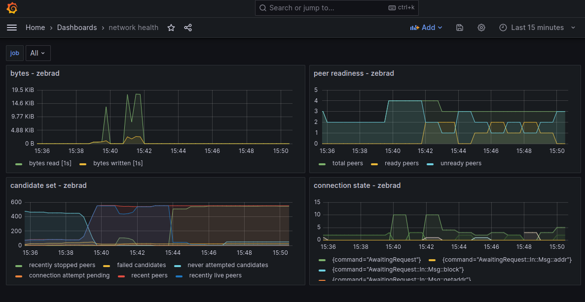

# Zebra Metrics

Zebra has support for Prometheus, configured using the `prometheus` compile-time feature,
and the [`MetricsSection`][metrics_section] runtime configuration.

The following steps can be used to send real time Zebra metrics data into a grafana
front end that you can visualize:

1. Get a Zebra binary with the `prometheus` feature. The [prebuilt release
   binaries and Docker images](https://zebra.zfnd.org/user/install.html)
   already include it, so no rebuild is needed. If you are building from
   source with a custom feature set, enable it explicitly:

   ```bash
   cargo install --features prometheus --locked --git https://github.com/ZcashFoundation/zebra zebrad
   ```

2. Create a `zebrad.toml` file that we can edit:

   ```bash
   zebrad generate -o zebrad.toml
   ```

3. Add `endpoint_addr` to the `metrics` section:

   ```toml
   [metrics]
   endpoint_addr = "127.0.0.1:9999"
   ```

4. Run Zebra, and specify the path to the `zebrad.toml` file, for example:

   ```bash
   zebrad -c zebrad.toml start
   ```

5. Install and run Prometheus and Grafana via Docker.

   First, save a minimal Prometheus config that scrapes the Zebra metrics
   endpoint configured above, for example as `prometheus.yaml`:

   ```yaml
   global:
     scrape_interval: 15s

   scrape_configs:
     - job_name: "zebra"
       metrics_path: "/metrics"
       static_configs:
         - targets: ["localhost:9999"]
   ```

   Then start both containers:

   ```bash
   # create a storage volume for grafana (once)
   sudo docker volume create grafana-storage
   # create a storage volume for prometheus (once)
   sudo docker volume create prometheus-storage

   # run prometheus with the config created above
   sudo docker run --detach --network host --volume prometheus-storage:/prometheus --volume /path/to/prometheus.yaml:/etc/prometheus/prometheus.yml prom/prometheus

   # run grafana
   sudo docker run --detach --network host --env GF_SERVER_HTTP_PORT=3030 --env GF_SERVER_HTTP_ADDR=localhost --volume grafana-storage:/var/lib/grafana grafana/grafana
   ```

   > **Note:** the config shipped at `docker/observability/prometheus/prometheus.yaml`
   > is written for the pre-configured
   > [observability stack](https://github.com/ZcashFoundation/zebra/blob/main/docker/observability/README.md)
   > and scrapes Compose service names such as `zebra:9999`, so it won't work with the
   > standalone host-networked container used here. If you'd rather skip this manual
   > setup, that stack starts Zebra, Prometheus, Grafana, Jaeger, and AlertManager
   > with a single command:
   >
   > ```bash
   > docker compose -f docker/docker-compose.observability.yml up
   > ```

   Now the grafana dashboard is available at [http://localhost:3030](http://localhost:3030) ; the default username and password is `admin`/`admin`.
   Prometheus scrapes Zebra on `localhost:9999`, and provides the results on `localhost:9090`.

6. Configure Grafana with a Prometheus HTTP Data Source, using Zebra's `metrics.endpoint_addr`.

   In the grafana dashboard:
   1. Create a new Prometheus Data Source `Prometheus-Zebra`
   2. Enter the HTTP URL: `127.0.0.1:9090`
   3. Save the configuration

7. Now you can add the grafana dashboards from `zebra/docker/observability/grafana/dashboards/` (Create > Import > Upload JSON File), or create your own.



[metrics_section]: https://docs.rs/zebrad/latest/zebrad/components/metrics/struct.Config.html

## Block timing

These histograms show how quickly a node accepts new blocks. Official release builds
also send them to [Sentry](tracing.md#sentry-production-monitoring) as distributions
when `SENTRY_DSN` is set, even with the Prometheus endpoint off.

| Metric | Unit | Description |
|---|---|---|
| `zcash.chain.tip.block_delay_seconds` | seconds | Time from a block's header time until it becomes this node's best chain tip. Recorded only for blocks mined after their parent was already this node's tip, so the blocks a node catches up on after a restart or a stall aren't counted. Negative when the miner's clock is ahead of this node's. |

The header time is set by the block's miner, so a single value is only approximate.
Nodes that follow the same chain see the same header times, so comparing these
values across nodes over the same period shows which nodes accept blocks sooner.

## Network metric aggregation

Connection state, request, response, message, and byte metrics are aggregated across
peers: they no longer have an `addr` label. `zebra.net.connection.state` counts live
connections by `command`, decrementing the old state on transitions and disconnects.
Request, response, and message counters retain their `command` labels.

Handshake counters (`zcash.net.peers.connected`, `zcash.net.peers.obsolete`, and
`zcash.net.peers.missing_services`) no longer have `remote_ip` or `user_agent` labels.
The `zcash.net.peers.version.connected` and `zcash.net.peers.version.obsolete` gauges
report the remote protocol version of the most recent corresponding handshake,
without a `remote_ip` label. `zebra.net.in.errors` also omits `addr`.

Update custom dashboards to remove selectors and joins using these removed labels.
The supplied dashboards use aggregate totals and the bounded `implementation` label
on `zcash.net.peer.version.outcomes.total` for successful handshake software breakdowns.
These are cumulative handshake counts, not counts of currently connected peers.
Peer addresses and full user agents remain available in logs and peer metadata.

Metric labels use bounded values:

- `mempool.failed.verify.tasks.total` `reason`: `in_state`, `state_error`,
  `download_failed`, `cancelled`, `invalid`, or `timeout`.
- `zebra.net.in.errors` `error`: `io`, `parse`, `utf8_error`,
  `try_from_slice_error`, `try_from_int_error`, `from_hex_error`, `amount`,
  `bad_transaction_balance`, `script`, `opcode`, or `num`.
- Handshake `remote_version` and `negotiated_version`: known protocol versions or
  `other`.
