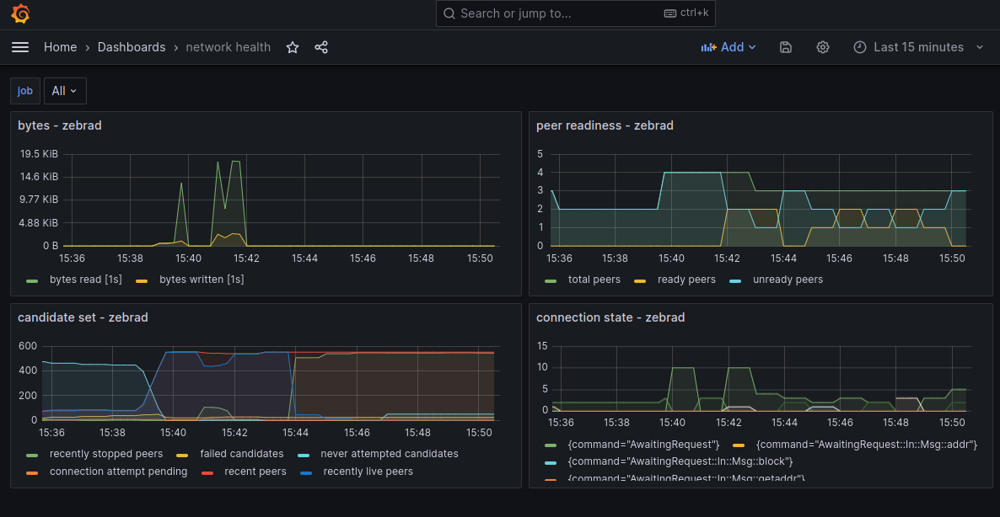

# Zebra Metrics

Zebra has support for Prometheus, configured using the `prometheus` compile-time feature,
and the [`MetricsSection`][metrics_section] runtime configuration.

The following steps can be used to send real time Zebra metrics data into a grafana
front end that you can visualize:

1. Get a Zebra binary with the `prometheus` feature. The [prebuilt release
   binaries and Docker images](https://zebra.zfnd.org/user/install.html)
   already include it, so no rebuild is needed. If you are building from
   source with a custom feature set, enable it explicitly:

   ```bash
   cargo install --features prometheus --locked --git https://github.com/ZcashFoundation/zebra zebrad
   ```

2. Create a `zebrad.toml` file that we can edit:

   ```bash
   zebrad generate -o zebrad.toml
   ```

3. Add `endpoint_addr` to the `metrics` section:

   ```toml
   [metrics]
   endpoint_addr = "127.0.0.1:9999"
   ```

4. Run Zebra, and specify the path to the `zebrad.toml` file, for example:

   ```bash
   zebrad -c zebrad.toml start
   ```

5. Install and run Prometheus and Grafana via Docker.

   First, save a minimal Prometheus config that scrapes the Zebra metrics
   endpoint configured above, for example as `prometheus.yaml`:

   ```yaml
   global:
     scrape_interval: 15s

   scrape_configs:
     - job_name: "zebra"
       metrics_path: "/metrics"
       static_configs:
         - targets: ["localhost:9999"]
   ```

   Then start both containers:

   ```bash
   # create a storage volume for grafana (once)
   sudo docker volume create grafana-storage
   # create a storage volume for prometheus (once)
   sudo docker volume create prometheus-storage

   # run prometheus with the config created above
   sudo docker run --detach --network host --volume prometheus-storage:/prometheus --volume /path/to/prometheus.yaml:/etc/prometheus/prometheus.yml prom/prometheus

   # run grafana
   sudo docker run --detach --network host --env GF_SERVER_HTTP_PORT=3030 --env GF_SERVER_HTTP_ADDR=localhost --volume grafana-storage:/var/lib/grafana grafana/grafana
   ```

   > **Note:** the config shipped at `docker/observability/prometheus/prometheus.yaml`
   > is written for the pre-configured
   > [observability stack](https://github.com/ZcashFoundation/zebra/blob/main/docker/observability/README.md)
   > and scrapes Compose service names such as `zebra:9999`, so it won't work with the
   > standalone host-networked container used here. If you'd rather skip this manual
   > setup, that stack starts Zebra, Prometheus, Grafana, Jaeger, and AlertManager
   > with a single command:
   >
   > ```bash
   > docker compose -f docker/docker-compose.observability.yml up
   > ```

   Now the grafana dashboard is available at [http://localhost:3030](http://localhost:3030) ; the default username and password is `admin`/`admin`.
   Prometheus scrapes Zebra on `localhost:9999`, and provides the results on `localhost:9090`.

6. Configure Grafana with a Prometheus HTTP Data Source, using Zebra's `metrics.endpoint_addr`.

   In the grafana dashboard:
   1. Create a new Prometheus Data Source `Prometheus-Zebra`
   2. Enter the HTTP URL: `127.0.0.1:9090`
   3. Save the configuration

7. Now you can add the grafana dashboards from `zebra/docker/observability/grafana/dashboards/` (Create > Import > Upload JSON File), or create your own.



[metrics_section]: https://docs.rs/zebrad/latest/zebrad/components/metrics/struct.Config.html

## Metric catalog

[`docker/observability/metrics-catalog.json`](https://github.com/ZcashFoundation/zebra/blob/main/docker/observability/metrics-catalog.json)
lists every metric Zebra records, with its kind, unit, description, label keys, and
the series names the Prometheus endpoint exports it as. The endpoint also shows each
description as a `# HELP` line. Prometheus names replace the dots in a metric's name
with underscores, and don't add a unit suffix.

Most histograms are exported as Prometheus summaries, with `quantile` series. These
histograms are exported as Prometheus histograms, with `_bucket` series that can be
aggregated across nodes:

- `rpc.request.duration_seconds`
- `zcash.net.peer.handshake.duration_seconds`
- every histogram in [Performance timing](#performance-timing)

The catalog file in a release lists that release's metrics, so you can check your own
dashboards and alerts against the version you run.

## Process metrics

When the Prometheus endpoint is open, or [Sentry](tracing.md#sentry-production-monitoring)
is active, Zebra samples its own process every 15 seconds and records the
standard Prometheus process metrics. They use the usual names, without a prefix,
so existing dashboards and alerts work unchanged. Zebra doesn't record them on
Windows.

| Metric | Unit | Description |
|---|---|---|
| `process_resident_memory_bytes` | bytes | Resident memory size. |
| `process_virtual_memory_bytes` | bytes | Virtual memory size. |
| `process_virtual_memory_max_bytes` | bytes | Maximum virtual memory available. |
| `process_open_fds` | count | Open file descriptors. |
| `process_max_fds` | count | Maximum open file descriptors. |
| `process_threads` | count | OS threads in the process. |
| `process_cpu_seconds_total` | seconds | Total user and system CPU time. |
| `process_start_time_seconds` | seconds | Start time of the process since the Unix epoch. |

Sentry receives all of them. It receives `process_cpu_seconds_total` as the CPU time
used in each minute.

`process_cpu_seconds_total` counts whole seconds, so use a window of a few
minutes, such as `rate(process_cpu_seconds_total[5m])`, to see steady CPU usage
on a lightly loaded node. The two maximums are left out when the limit is
unlimited.

## Block timing

These histograms show how quickly a node accepts new blocks. Official release builds
also send them to [Sentry](tracing.md#sentry-production-monitoring) as distributions
when `SENTRY_DSN` is set, even with the Prometheus endpoint off.

| Metric | Unit | Labels | Description |
|---|---|---|---|
| `zcash.chain.tip.block_delay_seconds` | seconds | `chain.network_upgrade` | Time from a block's header time until it becomes this node's best chain tip. Recorded only for blocks mined at most two minutes before their parent became this node's tip, so most of the blocks a node catches up on after a restart or a stall aren't counted, but a block that arrives while its parent is still being verified is. The block just before a network upgrade activates isn't counted either. Negative when the miner's clock is ahead of this node's. |

`chain.network_upgrade` is the network upgrade at the block's height, such as `Nu6`.
The Prometheus endpoint exports it as the `chain_network_upgrade` label.
Sentry also receives each value with the block's height as the number
`chain.height`. The Prometheus endpoint doesn't export the height, because each
height would become a new series.

The header time is set by the block's miner, so a single value is only approximate.
Nodes that follow the same chain see the same header times, so comparing these
values across nodes over the same period shows which nodes accept blocks sooner.
In Sentry, `chain.height` lets you compare nodes block by block.

## Performance timing

These histograms and counters show where a node spends its time on each block, block
template, and mempool update. Compare them between builds that run on the same
network, hardware, and height range. `zebrad_build_info` has a `commit` label, so
queries can group nodes by the commit they run.

| Metric | Unit | Labels | Description |
|---|---|---|---|
| `zebra.consensus.block.phase.duration_seconds` | seconds | `phase` | Time each phase of full block verification took: `block_checks`, `transaction_verification`, or `state_commit`. Recorded for blocks from sync, gossip, and `submitblock`, but not for block proposals. `block_checks` and `transaction_verification` are recorded when they pass, even if a later phase rejects the block. `state_commit` is recorded only for committed blocks, and includes any wait for the parent block. |
| `state.block_writer.phase.duration_seconds` | seconds | `phase` | Time each phase of committing a checkpoint-verified block took, from loading the history tree to the RocksDB write. The phases start with `checkpoint_`. |
| `zebra.net.block.decode.wait_seconds` | seconds | | Time a received block message waited for a rayon thread to start decoding it. |
| `zebra.net.block.decode.duration_seconds` | seconds | | Time taken to decode a received block message, including that wait. |
| `gossip.block.download.duration_seconds` | seconds | | Time taken to download a gossiped block from a peer. |
| `gossip.block.verify_commit.duration_seconds` | seconds | | Time from sending a downloaded gossiped block to the verifier until it was committed. |
| `rpc.getblocktemplate.build.duration_seconds` | seconds | | Time taken to select transactions and build a block template. |
| `rpc.getblocktemplate.first_template.duration_seconds` | seconds | | Time from a new best chain tip until the first block template on it was served. Miners keep working on the old tip for this long. |
| `rpc.submitblock.outcomes.total` | count | `outcome` | Blocks submitted with `submitblock`, by result: `accepted`, `duplicate`, `duplicate-inconclusive`, `inconclusive`, or `rejected`. |
| `sync.mined.block.announcement.duration_seconds` | seconds | | Time from a mined block's acceptance until its announcement to peers finished. |
| `sync.mined.block.announcement.outcomes.total` | count | `outcome` | Announcements of mined blocks, `completed` or `failed`. |
| `mempool.tip_cleanup.duration_seconds` | seconds | | Time taken to remove a new tip block's transactions and their conflicts from the mempool. |
| `mempool.expiry.duration_seconds` | seconds | | Time taken by each check of the mempool for expired transactions. |

For example, this query shows the 95th percentile of each block verification phase
for each commit:

```promql
histogram_quantile(0.95,
  sum by (le, phase, commit) (
    rate(zebra_consensus_block_phase_duration_seconds_bucket[1h])
    * on (instance) group_left (commit) zebrad_build_info
  )
)
```

## Sync stall metrics

These metrics show why the syncer stopped advancing the chain tip. Their labels have a fixed
set of values. Block heights and hashes are in the matching log fields instead.

Official release builds also send them to [Sentry](tracing.md#sentry-production-monitoring)
when `SENTRY_DSN` is set, even with the Prometheus endpoint off. Sentry receives each counter's
increase once a minute for each set of labels, and each gauge's latest value in the minute it
changes, and at least every 5 minutes.

| Metric | Type | Labels | Meaning |
| --- | --- | --- | --- |
| `sync.restart.count` | counter | `reason`, `made_progress` | Sync rounds that ended, by why they ended and whether the state tip advanced during the round |
| `sync.block.error.count` | counter | `kind` | Block download and verify errors, including the ones the syncer recovers from without restarting |
| `sync.downloads.oldest_age_seconds` | gauge | none | How long the oldest block still being downloaded or verified has been waiting, or 0 when none are |

`reason` is one of:

- `exhausted_tips`: the syncer downloaded every block its peers advertised. This is the normal end of a round.
- `obtain_tips_timeout` or `obtain_tips_error`: asking peers for new block hashes timed out or failed. If a block they returned was still waiting for network capacity when the timeout fired, the round ends as `block_error` with the `network_ready_timeout` kind instead.
- `extend_tips_error`: asking peers to extend the known hashes failed.
- `sync_step_timeout`: the state tip did not advance for the block verify timeout (8 minutes) during a round. Zebra backs off, then asks for new tips without cancelling pending downloads. A block that was waiting for network capacity is counted in `sync.block.error.count` with the `network_ready_timeout` kind.
- `block_error`: a block download or verify error restarted the sync. The error's `kind` is in the `waiting to restart sync` log.

`kind` names the error, for example `not_found`, `download_timed_out`, `invalid`, `verify_timeout`,
`utxo_lookup_timeout`, `already_verified`, or `cancelled`.

When a round fails without advancing the state tip, Zebra logs a `sync failed without advancing the
state tip` warning with the `reason`, `kind`, and `error`. A `sync_step_timeout` round is not a
failure, so it logs `waiting to restart sync` at INFO instead. The `chain updates have stalled`
warning includes the latest `last_restart` reason, `restarts_without_progress`, `in_flight`, and
`oldest_in_flight_secs`.

## Memory metrics

These metrics show how much memory `zebrad` uses, and how large the non-finalized state is.

Official release builds also send them to [Sentry](tracing.md#sentry-production-monitoring)
when `SENTRY_DSN` is set, even with the Prometheus endpoint off. Sentry receives the counter as
one total per minute, and each gauge's latest value once a minute.

| Metric | Type | Meaning |
| --- | --- | --- |
| `process.memory.rss_bytes` | gauge | Memory `zebrad` is using (its resident set size). Only on Linux. |
| `process.memory.rss_fraction` | gauge | `process.memory.rss_bytes` as a fraction of the memory `zebrad` can use: the tightest memory limit on its cgroup or any parent cgroup, or the machine's memory if that is smaller. The kernel stops the process near 1. |
| `state.memory.chain.count` | gauge | Non-finalized chains, the best chain and its forks |
| `state.memory.best.chain.length` | gauge | Blocks in the best non-finalized chain. Above the 1,000-block reorg limit, older blocks are waiting to be written to the database. |
| `state.memory.index.entries` | gauge | Blocks, transactions, transparent outputs and spends, and nullifiers indexed across all non-finalized chains, counting the blocks that chains share once |
| `state.memory.best.chain.index.entries` | gauge | The same count for the best chain only |
| `state.memory.fork.evicted.count` | counter | Forks dropped because the node tracked too many |
| `state.memory.backup.restored.block.count` | gauge | Blocks restored from the non-finalized backup at startup |
| `state.memory.backup.restore.duration_seconds` | gauge | How long restoring the non-finalized backup took at startup |

## Network metric aggregation

Connection state, request, response, message, and byte metrics are aggregated across
peers: they no longer have an `addr` label. `zebra.net.connection.state` counts live
connections by `command`, decrementing the old state on transitions and disconnects.
Request, response, and message counters retain their `command` labels.

Handshake counters (`zcash.net.peers.connected`, `zcash.net.peers.obsolete`, and
`zcash.net.peers.missing_services`) no longer have `remote_ip` or `user_agent` labels.
The `zcash.net.peers.version.connected` and `zcash.net.peers.version.obsolete` gauges
report the remote protocol version of the most recent corresponding handshake,
without a `remote_ip` label. `zebra.net.in.errors` also omits `addr`.

Update custom dashboards to remove selectors and joins using these removed labels.
The supplied dashboards use aggregate totals and the bounded `implementation` label
on `zcash.net.peer.version.outcomes.total` for successful handshake software breakdowns.
These are cumulative handshake counts, not counts of currently connected peers.
Peer addresses and full user agents remain available in logs and peer metadata.

Metric labels use bounded values:

- `mempool.failed.verify.tasks.total` `reason`: `in_state`, `state_error`,
  `download_failed`, `cancelled`, `invalid`, `non_standard`, or `timeout`.
- `zebra.net.in.errors` `error`: `io`, `parse`, `utf8_error`,
  `try_from_slice_error`, `try_from_int_error`, `from_hex_error`, `amount`,
  `bad_transaction_balance`, `script`, `opcode`, or `num`.
- Handshake `remote_version` and `negotiated_version`: known protocol versions or
  `other`.
- `zcash.net.peers.missing_services` `missing_service`: the required service the
  rejected peer doesn't advertise, `NODE_NETWORK`. It replaces the
  `remote_services` label, whose value was the service bits the peer sent.

`zcash.net.peers.initial` and `zcash.net.peers.cache` no longer have a `cache`
label with the peer cache file path. The `zcash.net.peers.initial` series without
a `seed` label counts the addresses from the peer cache.

The `seed` label of `zcash.net.peers.initial` names an entry from
`network.initial_mainnet_peers` or `network.initial_testnet_peers` only when it
is one of the default DNS seeders that Zebra ships, such as
`dnsseed.z.cash:8233`. Every other entry, including a custom host name or an IP
address and port, has the value `custom`, so private peer addresses don't reach
metrics in Prometheus or [Sentry](tracing.md#sentry-production-monitoring).
